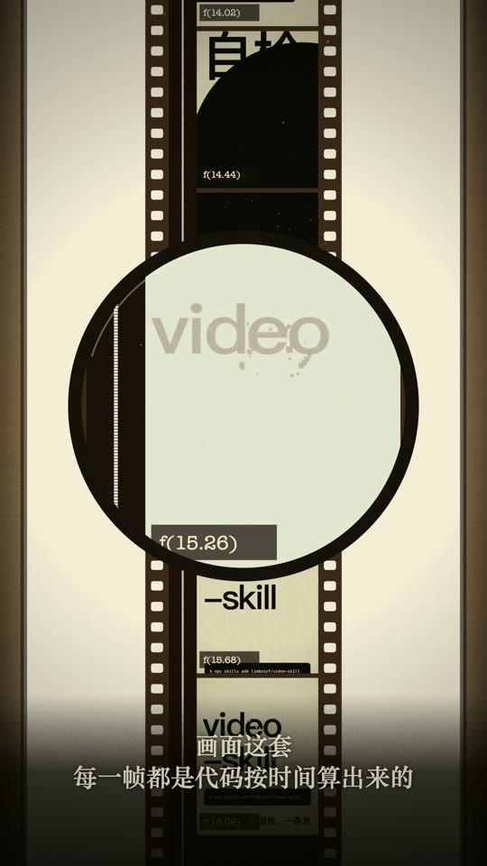
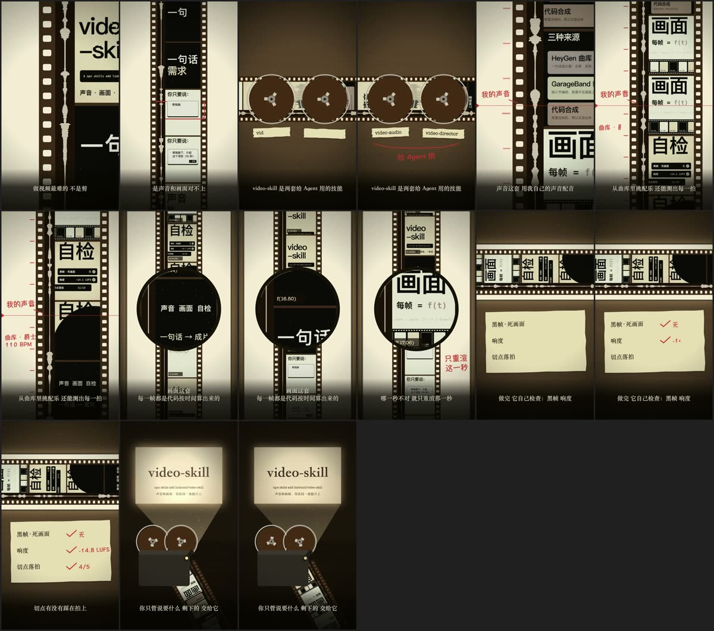
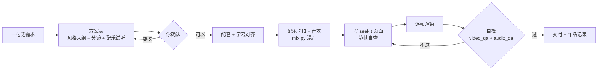
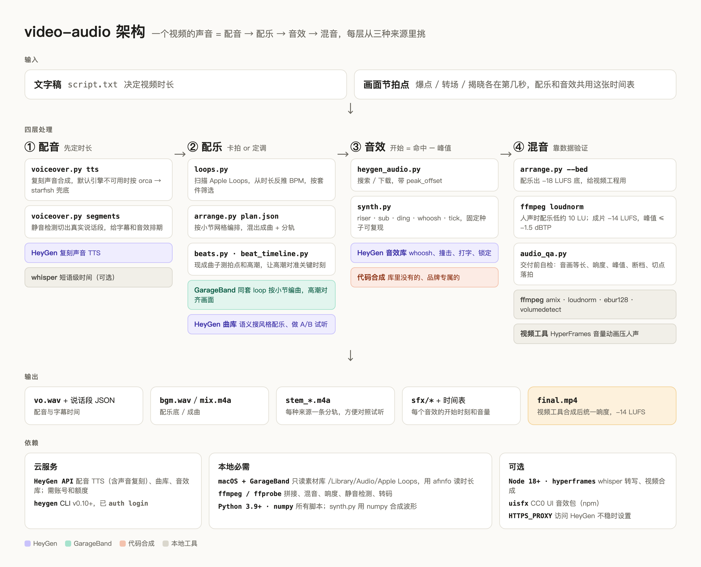

# video-skill

让 Agent 帮你做短视频的两个 skill：一个管声音，一个管画面。从一句话需求出发，先出方案给你确认，再配音、配乐、写代码逐帧渲染，最后用数据自检，过了才交付。

| skill | 管什么 |
|---|---|
| [`video-audio`](skills/video-audio/SKILL.md) | 声音：配音（你的复刻声音 / HeyGen 公共声音 / Gemini TTS）、字幕时间对齐、曲库配乐和音效、卡拍、混音、声音自检 |
| [`video-director`](skills/video-director/SKILL.md) | 画面：方案表（风格大纲 + 分镜）、构图和动作约束、模型直接写 `seek(t)` 代码逐帧渲染、成片自检、防雷同 |

## 示例：这个项目自己的 30 秒介绍片

[](docs/video-skill-intro-30s.mp4)

▶ [看片（30.5s，竖版）](docs/video-skill-intro-30s.mp4)

整条用这两个 skill 做完：

- **画面**：母题是一条 35mm 胶片，画面和声音本来就印在同一条胶片上。胶片边上的光学声带是这条配音的真实波形，画格是上一条片子的真实帧。全部是代码画出来的，没有用视频框架。
- **声音**：作者的 HeyGen 复刻声音配音；配乐来自 HeyGen 曲库（indie rock，145 BPM），它的爆发点砸在「画面这套」开口的那一刻；35 处转场和关键帧音效全是曲库里的真实录音。
- **自检**：说话时配乐比人声低 17 dB，每个音效低 ≥ 6 dB；-15.0 LUFS；5 个镜头切点 4 个落在拍上；无黑帧、无死画面。



---

## 工作流



**确认之前不花钱、不渲染**：配音要消耗额度，画面推倒重来最费时间，所以方向先定死。方案表包含：

- 风格大纲：主题风格、色板字体、配乐风格加 2–3 首**混进配音的**试听、配音来源、音效、节奏，以及和以往作品的区别。
- 分镜：每个画面渲染什么、以什么形式出现、怎么转场、配什么音效、配乐走到哪一段。

## 硬指标（脚本会量，不达标不交付）

| 指标 | 要求 | 谁来量 |
|---|---|---|
| 配乐不盖人声 | 说话时平均低 ≥ 12 dB（默认 15），最响的一秒低 ≥ 8 dB | `mix.py` |
| 音效不压人声 | 说话时每个音效的瞬时响度（K 加权）低 ≥ 6 dB，超了自动压 | `mix.py` |
| 成片响度 | -14 LUFS 附近，真峰值 ≤ -1.5 dBTP | `mix.py`、`audio_qa.py` |
| 转场和关键帧 | 每个切点、每个关键动作都有音效 | 分镜表 |
| 切点落拍 | 镜头切点 ≥ 70% 落在拍点 ±80ms 内 | `audio_qa.py` |
| 画面 | 无黑帧、无 > 1.5s 死画面、空底 < 50%、版式不雷同、每秒有变化 | `video_qa.py` |
| 字读得完 | 没配音的字停留 ≥ 字数 × 0.25s + 0.5s；跟配音的字幕按真实说话时间 | 分镜表、`voiceover.py align` |
| 不雷同 | 和作品记录里最近 3 条比，风格、色板、字体、开场、配乐、收尾至少 4 项不同；重冲击全片最多 2 次 | `~/.video-skill/作品记录.md` |

---

## video-audio：声音

把声音拆成四层：**配音 → 配乐 → 音效 → 混音**。

**配音**：`voiceover.py tts --source mine | heygen | gemini`。默认用你在 HeyGen 复刻的声音，也可以换 HeyGen 公共声音或 Gemini 3.8 Flash TTS（用 `--style` 一句话控制语气）。三种来源用同一份稿子、同一种停顿写法，都输出 48kHz 的 WAV。

**字幕时间不靠语音识别**：稿子是自己写的，`voiceover.py align` 先按长停顿对整句，再在句子内部对分句，每条字幕的起止都落在真实的换气上。实测比 whisper 准：同一段配音，whisper 把 28 秒识别成一整段，还认错了好几个字。

**配乐和音效优先走曲库**：

| 顺序 | 来源 | 什么时候用 |
|---|---|---|
| 1 | 你给的歌 | 给了就必须用 |
| 2 | **HeyGen 曲库 / 音效库**（默认） | 真实录音、风格多；曲风从主题推，产品介绍默认要动感、有推进力 |
| 3 | GarageBand（Apple Loops） | 曲库没有合适的，又必须按小节精确编排 |
| 4 | 代码合成 | 最后手段，只做库里没有的短音效 |

`beats.py` 测曲子的拍点和爆发点，`beat_timeline.py --key <关键时刻>` 算出曲子从第几秒开始放，让爆发砸在画面最重要的那一刻。

**混音**：一份 `mix.json` 写清所有声音，跑 `mix.py`。不靠压缩器猜，而是直接量人声和配乐的电平，按"低多少 dB"算出每一刻的音量。音效按峰值对齐，导出分轨，混完再量一遍。

### 试听：同一网格上的三种来源

`examples/hype-15s` 演示的是把 GarageBand、HeyGen 和代码合成放在同一个小节网格里混音的**机制**，不是推荐的风格。

| 文件 | 内容 |
|---|---|
| [hype15_mix.mp3](docs/audio/hype15_mix.mp3) | 成品：三种来源混在一起 |
| [hype15_garageband.mp3](docs/audio/hype15_garageband.mp3) · [hype15_heygen.mp3](docs/audio/hype15_heygen.mp3) · [hype15_code.mp3](docs/audio/hype15_code.mp3) | 三条分轨 |
| [synth_riser](docs/audio/synth_riser.mp3) · [sub](docs/audio/synth_sub.mp3) · [ding](docs/audio/synth_ding.mp3) · [whoosh](docs/audio/synth_whoosh.mp3) · [tick](docs/audio/synth_tick.mp3) | `synth.py` 合成的 5 种音效，固定种子，每次输出一样 |



> 在 GitHub 上点进 mp3 文件，再点 **View raw** 就能在浏览器里播放。架构图的源文件是 [docs/architecture.html](docs/architecture.html)。更早的一条介绍片：[video-audio-intro.mp4](docs/video-audio-intro.mp4)。

## video-director：画面

模型做视频最常见的翻车，不是渲不出来，而是做成了幻灯片：每个镜头同一个版式，深色空底上摆一张小卡片，动作又慢又软；或者越做越像同一个模板，也就是 AI Slop。`video-director` 把"拍成什么样才算合格"写成能判对错的约束：

| 环节 | 做什么 |
|---|---|
| 方案表 | 风格大纲 + 分镜，先给你确认 |
| 个性化表达 | 每条片子要有一个从内容里长出来的母题，和一处换个主题就做不出来的高光；动手前读作品记录，和以往作品拉开 |
| 画面约束 | 主体 ≥ 画面高度 1/3、至少 4 种景别、大字砸进来、4–5 种转场轮换、去掉界面装饰 |
| 动作约束 | 按动作类型定时长和缓动（砸下 3–4 帧、入场 0.3s、走位 0.6s）；按事件写、不按周期写；镜头推完要停 |
| 渲染 | 默认模型直接写 `seek(t)` 网页（每一帧只由时间 t 算出来），`render.mjs` 用无头 Chrome 逐帧截图，可以并行、断点续渲、只重渲某一段。你点名时才用 HyperFrames 或 Remotion |
| 成片自检 | `video_qa.py` 查规格、黑帧、死画面、切点、空底、版式雷同、每秒变化，输出联系表和手机尺寸图；按 10 项评分表打分，返工最多 3 轮 |

两个 skill 之间只通过文件衔接：`timeline.json`（拍点）、`cues.json`（字幕时间）、`mix.wav`（混好的声音）、`data.js`（`film_data.py` 导出的拍点、字幕、配音波形和建议切点）。

## 改动成本

渲染 30 秒片子约 16 秒，混音几秒，所以大部分微调很便宜：

| 改什么 | 大概多久 |
|---|---|
| 换一个音效、调音量 | 约 1 分钟（画面帧全部复用，只重新编码） |
| 改字、颜色、某个动作 | 1–2 分钟 |
| 换配乐 | 5–10 分钟（大头是你挑） |
| 改配音稿 | 10–15 分钟（后面的时间点都会挪；事件挂在台词上之后，能降到 2–3 分钟） |

---

## 安装

```bash
npx skills add limboinf/video-skill --skill video-audio -g -a claude-code -y
npx skills add limboinf/video-skill --skill video-director -g -a claude-code -y
```

手动安装：把 `skills/` 下的目录复制或软链到 `~/.claude/skills/`。

## 依赖

| 组件 / 服务 | 用在哪里 | 必需？ | 安装 / 配置 |
|---|---|---|---|
| ffmpeg / ffprobe | 所有脚本 | 必需 | `brew install ffmpeg` |
| Python 3.9+ · numpy | 所有 Python 脚本 | 必需 | `pip install numpy` |
| Node 18+ · playwright-core · Google Chrome | `render.mjs` 逐帧渲染 | 做画面时必需 | 在做片的工作目录 `npm i playwright-core`；有系统 Chrome 就不用另外下载浏览器 |
| HeyGen CLI v0.10+ · 账号额度 | 复刻声音 / 公共声音配音，曲库和音效库 | 用 HeyGen 时必需 | 见 [HeyGen 开发者文档](https://developers.heygen.com)，然后 `heygen auth login`；配音会消耗语音额度 |
| Gemini API | `voiceover.py --source gemini` | 用 Gemini 配音时必需 | 在 Google AI Studio 申请密钥，`export GEMINI_API_KEY=...` |
| macOS + GarageBand | `loops.py`、`arrange.py` 只读 `/Library/Audio/Apple Loops` | 用 GarageBand 时必需 | App Store 安装；更多乐器在「声音资源库」里下载 |
| HyperFrames / Remotion | 只在你点名时用来搭画面 | 可选 | 按各自文档安装 |
| whisper | 逐字高亮这类比分句更细的时间 | 可选 | `pip install openai-whisper` |
| `HTTPS_PROXY` | 访问 HeyGen / Gemini 不稳定时 | 可选 | 例如 `export HTTPS_PROXY=http://127.0.0.1:7897` |

**授权提醒（未查证，商用前请自行确认）**：Apple Loops 一般允许用在自己创作的作品里，但不能单独再分发 loop 本身；HeyGen 素材拿到平台外使用，以 HeyGen 条款为准；代码合成的声音完全归你。

## 结构

```
skills/video-audio/
├── SKILL.md                 # 入口：来源优先级、配乐和音效的硬规则、工作流
├── references/
│   ├── voiceover.md         # 三种配音来源、停顿写法、字幕对齐
│   ├── music.md             # 选曲（贴主题、动感）、测拍、高潮对准关键时刻、GarageBand 编曲
│   ├── sfx.md               # 密度档位（默认每个切点和关键帧都有）、搜索词、对齐
│   └── mixing.md            # mix.py、目标电平、响度标准、验证命令
├── scripts/
│   ├── voiceover.py         # 列声音 / TTS（mine · heygen · gemini）/ 静音切段 / 字幕对齐
│   ├── heygen_audio.py      # 曲库和音效库：多词搜索、按时长过滤、批量下载
│   ├── beats.py             # 测 BPM、拍点、重拍、爆发点
│   ├── beat_timeline.py     # 让爆发对准关键时刻，出卡点时间表
│   ├── mix.py               # mix.json → 成片声音 + 分轨，配乐和音效都不许盖过人声
│   ├── audio_qa.py          # 交付前声音自检：时长、响度、峰值、断档、淡出、落拍
│   ├── loops.py / arrange.py # GarageBand 素材筛选、按小节编曲
│   └── synth.py             # 代码合成短音效
└── examples/hype-15s/       # 三种来源同一网格的示例
skills/video-director/
├── SKILL.md                 # 入口：用什么做、铁律、流程（含确认关卡）、省时间清单、评分表
├── references/
│   ├── director-sheet.md    # 方案两张表（风格大纲、分镜）+ 导演单
│   ├── originality.md       # 母题和高光、作品记录、AI 默认审美清单、冲击预算
│   ├── composition.md       # 别做成幻灯片：铺满、景别、大字、转场、字幕
│   ├── motion.md            # 节奏档、动作时长和缓动、按事件写、主辅分工、相机
│   ├── style-cards.md       # 风格名 → 看得见的元素清单、质感层
│   ├── render.md            # seek(t) 引擎规矩、渲染命令、性能、常见坑
│   └── qa.md                # 静帧自查、成片指标、返工循环、翻车清单
├── templates/
│   ├── engine.html          # seek(t) 模板页
│   └── lib.js               # 工具库：缓动、动作、事件、相机、字幕、图片铺满、波形
└── scripts/
    ├── film_data.py         # 拍点、字幕、配音波形、建议切点 → data.js
    ├── render.mjs           # seek(t) 页面 → 静帧拼图 / mp4
    └── video_qa.py          # 成片画面自检
docs/                        # 示例片、联系表、架构图、试听 mp3
NOTICE.md                    # 第三方代码致谢与授权
```

## 路线图

- [x] 声音：配音（三种来源）、字幕对齐、曲库配乐和音效、卡拍、混音
- [x] 画面：方案确认、构图和动作约束、逐帧渲染、成片自检、防雷同
- [x] 端到端示例：上面的 30 秒介绍片
- [ ] 画面上的实测数字自动对账（页面里写的数和自检报告对不上就报警）
- [ ] 画面事件挂在台词上（改配音稿后自动跟着走）
- [ ] 动作测量：逐帧光流量动作快慢、起停形状、原地晃动

## 致谢

`beats.py`、`beat_timeline.py`、`render.mjs`、`templates/engine.html` 移植自 [chuspeeism/code-video-director](https://github.com/chuspeeism/code-video-director)（MIT），并修了电子乐拍点偏半拍的问题；`video_qa.py` 的检查项和阈值、`video-director` 的约束体系也参考了它。详见 [NOTICE.md](NOTICE.md)。
